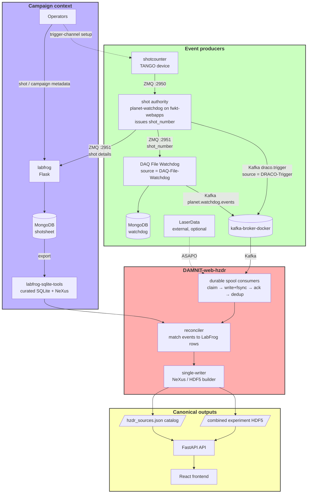

# System Overview: How the HZDR Repositories Work Together

This is the orientation map for the HZDR experimental data pipeline. It introduces
each repository, shows the end-to-end data flow, names the shared contracts that
hold the system together, and explains what the **end products** are and where
they land (here, in DAMNIT-web-hzdr).

For the precise data model and matching rules, see [architecture.md](architecture.md).
For per-item status and remaining work, see [integration-roadmap.md](status/integration-roadmap.md).
This document stays at the "what talks to what, and why" level.

## One-Sentence Summary

Instruments and trigger devices publish **immutable source events**; LabFrog owns
**campaign and shot context**; DAMNIT-web-hzdr **matches them once** and publishes
**one canonical per-campaign view** (a NeXus file plus a source catalog) that the
web UI reads.

## The Repositories

| Repository | Role | Stack | Position in the flow |
| --- | --- | --- | --- |
| **labfrog** | Operator captures structured shot/campaign metadata ("the shotsheet") | Flask + MongoDB | Source of truth for campaign + shot context |
| **labfrog-sqlite-tools-repo** | Exports LabFrog Mongo records to curated SQLite / NeXus / openPMD | Python CLI (`labfrog-sqlite`) | Turns LabFrog records into a portable, immutable export |
| **shotcounter** | TANGO device server at DRACO; counts laser triggers and announces each one over ZMQ. Its counters reset when it restarts, so its numbers are not the shot identity | PyTango + ZMQ | Trigger source for the shot authority |
| **planet-watchdog** | Two jobs. The **shot authority** (one ZMQ listener on fwkt-webapps) numbers every shotcounter trigger, republishes it on ZMQ and writes it to Kafka `draco.trigger`. The **DAQ File Watchdog** on the instrument PCs watches folders, parses files and publishes Watchdog source events over Kafka | Python + `watchdog` + ZMQ | Producer (`source = DRACO-Trigger` for numbered triggers, `DAQ-File-Watchdog` for files) |
| **kafka-broker-docker** | Single-node Kafka broker + helper scripts and examples | Docker Compose (KRaft) | Transport (local/dev message bus) |
| **asapo-for-hzdr-damnit** | Local harness proving the event contract + ASAPO/Kafka staging semantics | Node + Python | Transport test rig + contract reference |
| **DAMNIT-web-hzdr** | Reconciler/builder + FastAPI API + React frontend | Python + TS | Consumer; builds and serves the canonical outputs |
| **shot-aligner** | Proof of concept and precursor to the automated flow: rebuilds, after the fact, which instrument files belong to which shot, and writes per-shot NeXus once a person has reviewed each link | Python (`uv`) + Flask review app | Outside the flow: reads the rawdata and Shotlists shares, publishes no events — see [Before the chain](#before-the-chain-the-laser-shot-aligner) |
| **scicat_plugin** | Registers file/path references + metadata in SciCat (reuses `scicat-ingestor` worker codepaths; no binary upload) | Flask + `scicat-ingestor` | Sink; SciCat catalog registration (producer-side per file, or DAMNIT-side per campaign NeXus file) — see [integration-roadmap.md §SciCat Registration](status/integration-roadmap.md#scicat-registration) |

A third producer, **LaserData** (`source = LaserData`, transported over ASAPO),
exists in the wider HZDR setup but is not one of these repositories. It is
optional (2026-10-02): the deployment is complete with Kafka alone, and it is
not a Kafka-pilot or Semantic Test Baseline blocker. When activated, it will
produce events of the same shape described below.

## End-to-End Data Flow



> All source events sent into DAMNIT carry the same `hzdr-event-v1` envelope
> (see the contracts below). `asapo-for-hzdr-damnit` is the local harness that
> proves this flow without a real broker; it stands in for the Kafka/ASAPO
> transport during development.

**The flow in words:**

1. **Operators** enter campaign and shot metadata in **LabFrog**, which stores
   it in MongoDB. Selecting a shot in LabFrog claims the shot authority's number
   for that record.
2. **labfrog-sqlite-tools** exports those Mongo records into an immutable curated
   SQLite + NeXus bundle (every 15 minutes on fwkt-webapps), stamping the
   canonical `experiment_id`, the claimed `authority_shot_number` (schema 13)
   and linking columns (`kafka_event_id`, transport offsets, `damnit_*` hints).
3. **shotcounter** sends a ZMQ message for each channel that fires to the
   **shot authority**, a separate service on fwkt-webapps built from
   planet-watchdog's code (since 2026-10-02). The authority gives each shot its
   `shot_number`/`shot_id` (never decreasing except by a manual rebase, kept
   across restarts), republishes the stamped message on ZMQ `:2951` for LabFrog
   and the DAQ File Watchdogs, and writes it to Kafka `draco.trigger` with
   `experiment_id: "unassigned"`: it does not know campaigns.
4. **Instrument producers** publish immutable *source events*, carrying that
   shot number when they can attribute the data to one shot:
   - **planet-watchdog** (DAQ File Watchdog) parses new instrument files and
     publishes Watchdog events to DAMNIT over Kafka `planet.watchdog.events`.
     No instrument PC runs one yet.
   - **LaserData** (external, optional) would publish LaserData events to DAMNIT
     over ASAPO.
   - **asapo-for-hzdr-damnit** is the local rig that proves this contract and the
     staging semantics without a real broker.
5. **DAMNIT-web-hzdr** consumes events through durable spool consumers
   (claim → write+fsync → ack → dedup); unassigned triggers land in
   `_unassigned/`. The builder assigns each one to a campaign (the LabFrog
   record that claimed its shot number, then the campaign schedule, then a
   reviewer's ruling in Review matches; otherwise it stays in the
   `_unassigned` bucket), matches each event to the right LabFrog shot row, and
   writes the canonical outputs as a single writer.
6. The **API and frontend** read those outputs. DAMNIT never asks producers to
   edit the canonical file or make their own matching decisions.

### Before the chain: the Laser Shot Aligner

**shot-aligner** is not part of this flow and publishes no events. It is a
proof of concept, and the precursor to the automated version: it works on the
instrument folders and shot workbooks already on the rawdata and Shotlists
shares, and reconstructs **after the fact** which files belong to which shot —
fitting each diagnostic's clock against an anchor, aligning the resulting shot
events with the workbook's rows, and having a person review every link before
it writes one NeXus container per shot.

What it has to infer is what this chain records at the source: the `shot_id`
that the shot authority issues, and the `experiment_id + shot_id` join below. Its
`governed-keys.md` records, for every key in `METADATA_KEY_REGISTRY`, whether
the aligner adopts or refuses it; its containers are not built or registered
through DAMNIT. See the hub's
[shot-aligner page](https://codebase.helmholtz.cloud/fwk/fwkt/fwkt-data-management/infrastructure/fwkt-webapps/-/blob/main/docs/projects/shot-aligner.md).

## The Contracts That Hold It Together

Three shared agreements are what let seven independently-developed repos cooperate.
Changing any of them is a cross-repo change.

### 1. The event envelope — `hzdr-event-v1`

Every transport event (Kafka, ASAPO, ZMQ) converges on one shape. The canonical
definition is the `HZDREventV1` Pydantic model at
`api/src/damnit_api/metadata/hzdr_event.py`. Because some producers do not share a
Python package with DAMNIT, the model is **vendored** into each producer/consumer,
and a committed JSON-Schema + sample fixture (`api/tests/fixtures/hzdr-event-v1.*`)
is copied byte-identically into each repo's `tests/fixtures/`. Each repo's
`test_hzdr_event.py` asserts its own copy matches — so a contract change shows up
as a failing test in every repo until the copies are re-synced. See
**Event Envelope** in [architecture.md](architecture.md) for the full field list.

Key fields: `schema_version`, `event_id` (stable, retry-safe), `experiment_id`,
`shot_id`/`shot_number`, `source`, `kind`, `timestamp` (UTC), `transport`,
`payload_ref` (source traceability), and optional `values`/`metadata`.

### 2. The identity / join key

Events and LabFrog rows are matched on **`experiment_id + shot_id`**. The canonical
shot key is:

```text
<experiment_id>:<local YYYYMMDD>:<shot_number padded to 6>
```

The date component keeps keys apart for older data whose shot numbers
restarted. Since 2026-10-02 the governed `shot_number` comes only from the shot
authority (planet-watchdog), which never reuses a number. It stays nullable
(`int | None`): a producer without an authoritative number sends `null`, never
a local count. DAMNIT's matcher resolves identity-first (exact Kafka event id →
transport position → authoritative shot number → timestamp disambiguation →
fallbacks); the full ordering is in [architecture.md](architecture.md#matching).

### 3. The transports and their staging rule

Kafka and ASAPO are interchangeable transport options; ZMQ is an upstream
Draco/Watchdog detail. Whatever the transport, the consumer obeys one invariant:

> A message is acknowledged **if and only if** its event file has been written and
> fsync'd to the durable spool. Claim → write+flush → ack → dedup-by-`event_id`.

This is what `asapo-for-hzdr-damnit` exists to prove locally, and what
`DAMNIT-web-hzdr`'s `consumer/spool.py`, `consumer/asapo.py`, and
`consumer/kafka.py` implement for production.

## The End Products (What Lands Here)

The pipeline's output — the thing you are "sending here" — is a single canonical
view per campaign, built by DAMNIT and read by its API/frontend:

- **Combined experiment NeXus file**, one per campaign — preserves the LabFrog
  NeXus structure and adds DAMNIT's reconciliation result:

  ```text
  /entry/shots          canonical shot rows and match provenance
  /entry/source_events  normalized events, including unmatched ones
  /entry/data_products  files and internal dataset references
  /entry/laserdata      embedded small event arrays
  /entry/watchdog       Watchdog-derived values when present
  ```

- **Per-shot containers** (merged, not yet switched on in production): with
  `DW_API_HZDR_BUILDER__CONTAINERS_ENABLED=true` the builder converts each
  shot's bulk files into `shots/<YYYYMMDD>_<shot>.nxs` beside the campaign file,
  which then links them as a master.
- **`hzdr_sources.json`** — the source catalog that exposes the file through the
  HZDR API, written atomically (temp file + rename) on every build, with operator
  confirm/dismiss decisions persisted in a `hzdr_sources.review.jsonl` sidecar.
- **Curated SQLite / NeXus export** (from labfrog-sqlite-tools) — the immutable
  per-campaign LabFrog export that feeds the build and is retained for replay and
  audit. DAMNIT output is kept separate from this immutable input.

`runs.sqlite` is an optional future projection for legacy DAMNIT table workflows,
not a source of truth.

### Where the end products physically land

The spool is rooted at the DAMNIT data directory, `DW_API_DAMNIT_PATH` (the
production template uses `/data/damnit/hzdr`). In production the builder runs
inside the API in multi-campaign mode and writes under
`DW_API_HZDR_BUILDER__OUTPUT_ROOT` (on fwkt-webapps the bigdata share,
`/bigdata/HPLexp/nexus`): `<root>/<campaign>/<campaign>.nxs`,
`<root>/_unassigned/unassigned.nxs` and one shared `hzdr_sources.json`
([deployment-plan.md](plans/deployment-plan.md) Step 2b). The pieces arrive
and are consumed like this:

| Artifact | Produced by | Path / naming | Consumed by |
| --- | --- | --- | --- |
| Staged events | spool consumers in this API | `<DAMNIT_PATH>/spool/kafka/<campaign or _unassigned>/trigger.jsonl` and `<DAMNIT_PATH>/spool/asapo/<campaign>/events.jsonl` | the builder (`--events-jsonl`, `--trigger-jsonl`, `--watchdog-jsonl`) |
| Immutable LabFrog export | labfrog-sqlite-tools | curated `*.sqlite` + `*.nxs` per campaign (kept separate from DAMNIT output) | the builder (`--labfrog-sqlite`, `--labfrog-nexus`) |
| Combined NeXus file | `hzdr-hdf5-builder.py` (`--output-nexus`/`--output-hdf5`, required) | a campaign `.nxs`/`.h5`; each catalog source records its `hdf5_path` | API shot detail / dataset preview |
| Source catalog | same builder (`write_sources_catalog`) | `hzdr_sources.json`, default written **next to the NeXus file** unless `--sources-file` overrides | API (`DW_API_METADATA__SOURCES_FILE`) |
| Operator review decisions | API confirm/dismiss endpoints | `hzdr_sources.review.jsonl` sidecar, merged on each rebuild (`VERIFIED > REVIEWED > BASE`) | the builder, on the next run |

The handoff into this app is one setting:
`DW_API_METADATA__PROVIDER=local` points the API at `hzdr_sources.json` on disk
(set `=mongo` to read the same catalog from a MongoDB collection instead). The
builder is **single-writer** per campaign (PID-stamped lock on the output file),
so it can safely run on a schedule while the API reads. Build it, then publish the
catalog atomically (temp file + rename) — the API and frontend pick up the new
end products on their next read with no restart.

A single-campaign build by hand, which ties the inputs to the outputs
(the example slug is illustrative):

```bash
python api/scripts/hzdr-hdf5-builder.py \
  --experiment-id Solenoid_Beamline_Tests_01.2025 \
  --campaign-timezone Europe/Berlin \
  --labfrog-sqlite  <campaign>.sqlite \
  --trigger-jsonl   spool/kafka/<campaign>/trigger.jsonl \
  --events-jsonl    spool/asapo/<campaign>/events.jsonl \
  --output-nexus    <campaign>.nxs
# -> writes <campaign>.nxs and (next to it) hzdr_sources.json
```

### Operational read-only views (for the operator UI)

Alongside the canonical outputs, the API exposes three derived, read-only views
that back the operator pages without writing anything or joining a broker
consumer group (full detail in
[architecture.md](architecture.md#read-only-operational-views)):

| View | Endpoint(s) | Reads | Backs |
| --- | --- | --- | --- |
| Curated LabFrog campaigns | `GET /metadata/hzdr/campaigns`, `.../{campaign_key}/shots` | `labfrog-sqlite-tools` `curated_files/*.sqlite` (read-only), via `DW_API_METADATA__LABFROG_CURATED_DIR` | Review matches campaign suggestions (the shots preview has no UI since 2026-10-03) |
| Producer status | `GET /metadata/hzdr/sources/{key}/producer-status` | events already on the source (no new I/O) | DAQ File Watchdog hosts + Shotcounter liveness |
| Flow activity | `GET /config/flow-activity` | Kafka offset counts, spool JSONL line counts, optional ASAPO stream sizes | Flow Monitor **Live** mode |

Each gatherer is defensive: a broker that is down, a missing client, or an
unconfigured path yields an empty / `available=false` block rather than failing
the request, so these are safe to poll even while the real spool consumers are
disabled.

## Running the Whole Thing Locally

Each repo has its own `CLAUDE.md` and `README.md` with exact commands. The fastest
ways in:

- **Everything at once (tests):** `hzdr/scripts/test-all.ps1` in this repo runs all six
  sibling test suites in one command.
- **The contract + transport, no real broker:** `asapo-for-hzdr-damnit` →
  `launch-testing-suite.cmd` (local broker + GUI at `http://127.0.0.1:8765/`).
- **A real local Kafka broker:** `kafka-broker-docker` → `./deploy.sh`.
- **The shotsheet app:** `labfrog` → `uv run poe debug-with-dockerdb`.
- **A trigger producer:** `planet-watchdog` → `testing/tools/fake_zmq_publisher.py`
  feeding a local shot authority (`docs/LOCAL_TESTING.md`, `docs/SHOT_AUTHORITY.md`).
- **The file watcher (safe demo):** `planet-watchdog` → `uv run watchdog_test.py`.
- **This app (consumer + UI):** see [local-development.md](guides/local-development.md).

## Production Deployment

The API + frontend are live at
[https://fwkt-damnit.fz-rossendorf.de/](https://fwkt-damnit.fz-rossendorf.de/),
run by systemd from the git checkout `~/DAMNIT-web-hzdr` on fwkt-webapps
(`hzdr/scripts/damnit-api-checkout.service.example`; there is no `/opt` tree)
with an `.env.production.example`-derived `api/.env`, served behind the `frontend/nginx`
proxy templates, with LDAP auth against `ldap.fz-rossendorf.de`. Since
2026-10-03 the Kafka spool consumer and the multi-campaign builder are on
(first campaign `Beamline_radbio_2026`), and builds register in the internal
SciCat (`vlsscicat.fz-rossendorf.de`). No message has reached `draco.trigger`
yet, so intake from a real shot is unproven. The ASAPO spool consumer stays
off (optional). What runs is recorded in the HZDR_combo integration ledger
(`combo/integration-status.json`), not here.

## Where to Go Deeper

| You want… | Read |
| --- | --- |
| The exact data model, fields, and matching order | [architecture.md](architecture.md) |
| Per-repo status and the work remaining to go live | [integration-roadmap.md](status/integration-roadmap.md) |
| Verified test coverage and acceptance tests | [testing.md](status/testing.md) |
| Minimal build/test/launch for this app | [local-development.md](guides/local-development.md) |
| A current-state snapshot for the next session | [handoff.md](status/handoff.md) |
| How any single repo is built and run | that repo's `CLAUDE.md` and `README.md` |
